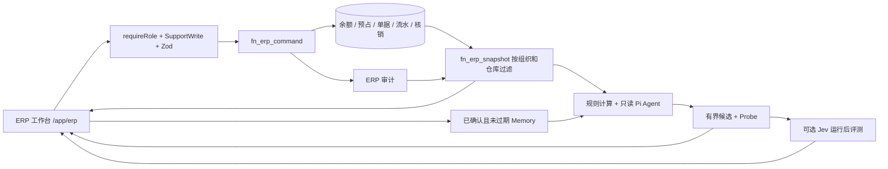

# ERP 分支架构

ERP RPC 通过 server-only `lib/erp/server.ts` 调用；org/actor 来自已验证的会话。PostgreSQL 再检查当前成员身份和业务权限。ERP 核心表拒绝浏览器直接写入，防止绕过账本规则。

库存采用 on_hand、reserved、available 三个概念。采购下单增加在途业务预期，收货才增加实物量；预占减少可用量，发货才减少实物量。所有变动追加流水，退货通过反向业务操作处理，不删除历史。

原 `catalog_products` 的单个库存字段、外部电商 `orders` 镜像和服务 `sales` 单据不充当 ERP 账本。它们仍属于原 CRM。旧数据不会自动转成 ERP 公司、SKU 和期初余额；上线迁移应先对账，再通过明确定义的导入流程初始化。

当前范围为轻量采购/库存/订单履约 ERP；制造 BOM、MRP、生产工单、总账会计、税务、真实银行支付和外部 ERP 适配器均需另建业务模块。
